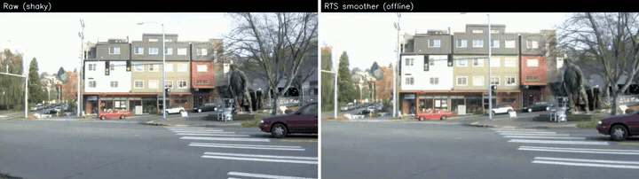

# Video stabilisation with a Kalman filter and RTS smoother

Estimates the camera's shaky trajectory from a video, recovers the *intended*
camera path with a linear Kalman filter (and an offline RTS smoother), and
warps each frame to follow the smooth path. Moving-average smoothing is
included as a baseline, and everything is scored with quantitative metrics.

## Demo

A hand-held street video before (left) and after (right) stabilisation with the
RTS smoother. The first 6 seconds are shown.



Full videos:

- [Original shaky video](data/videoShake.m4v)
- [Side-by-side comparison: raw | Kalman filter | RTS smoother](results_real/comparison_raw_kf_rts.mp4)

| Method (real video) | ITF (dB) ↑ | Jitter ↓ | Max correction (px) ↓ |
|---|---|---|---|
| Raw (shaky) | 18.69 | 1.793 | 0.0 |
| Kalman filter (causal) | 21.92 | 0.524 | 26.5 |
| RTS smoother (offline) | 27.11 | 0.072 | 23.8 |

## Setup

```bash
pip install -r requirements.txt
```

Python 3.9+ with OpenCV, NumPy and Matplotlib. `ffmpeg` is optional; if it is
installed the output video is re-encoded to H.264 so it plays everywhere.

## Run

**1. Validate on synthetic video with known ground truth**

```bash
python synth_video.py --out data/synthetic_shaky
python stabilize.py --video data/synthetic_shaky.mp4 \
                    --gt data/synthetic_shaky_groundtruth.npz \
                    --out results_synthetic
```

**2. Run on your own phone video**

```bash
python stabilize.py --video my_clip.mp4 --out results_real
```

Useful options: `--q-ratio` (Q/R, default `3e-4`; smaller is smoother but lags
more), `--ma-window` (baseline window, default 15), `--zoom` (border crop,
default 1.12), `--max-width` (downscale for speed, default 960).

Recording tips: 15–30 s at 720p or 1080p, walk while filming so there is real
shake, and include one deliberate pan or turn so the lag differences show.

## Files

| File | Purpose |
|---|---|
| `kalman.py` | Constant-velocity model, Kalman filter (Joseph-form update), RTS smoother, moving averages |
| `stabilize.py` | Motion estimation, smoothing, frame warping, metrics, Q sweep, plots |
| `synth_video.py` | Synthetic shaky video with ground-truth shaky and intended paths |

## Outputs

| Output | What it shows |
|---|---|
| `comparison_raw_kf_rts.mp4` | Side-by-side: raw, Kalman filter, RTS smoother |
| `trajectories.png` | x, y, rotation paths for raw, all four smoothers, and ground truth |
| `trajectories_pan_zoom.png` | Close-up of the deliberate pan, where lag differences are visible |
| `tradeoff_q_sweep.png` | Smoothness vs fidelity as Q (or the MA window) is swept |
| `kf_diagnostics.png` | Innovations with ±2√S bounds, NIS, and Kalman gain convergence |
| `metrics.json` | All numbers below, plus settings and the estimated R |

## Method

**Motion estimation.** Shi–Tomasi corners are tracked between consecutive
frames with pyramidal Lucas–Kanade optical flow, and a similarity transform
(translation + rotation) is fitted with RANSAC to reject outliers such as
moving objects. This gives per-frame motion (Δx, Δy, Δθ); the cumulative sum is
the raw camera trajectory.

**State-space model** (one independent filter per axis, Δt = 1 frame):

- State x_k = [p_k, v_k]ᵀ (position and velocity of the camera path)
- Process: x_k = F x_{k−1} + w_k, F = [[1, 1], [0, 1]], Q = q · G Gᵀ with G = [½, 1]ᵀ
  (discrete white-noise acceleration: the intended motion changes velocity smoothly)
- Measurement: z_k = H x_k + v_k, H = [1, 0], v_k ~ N(0, R). The shake is treated as measurement noise.

**R** is estimated from the data as the variance of the trajectory minus a
centred moving average. **Q** is set as `q_ratio × R`, so one dimensionless
parameter controls the smoothing on all three axes.

**RTS smoother.** Because a recorded video is processed offline, a backward
Rauch–Tung–Striebel pass can use future frames as well, removing the filter's
lag on intentional motion.

**Correction.** Each frame is warped by (smoothed − raw) and zoomed slightly
to hide the moving black borders.

## Results on the synthetic video (default settings)

| Method | ITF (dB) ↑ | Jitter ↓ | Max correction (px) ↓ | RMSE to intended path (px) ↓ |
|---|---|---|---|---|
| Raw (shaky) | 25.82 | 1.314 | 0.0 | 8.68 |
| Moving average, causal | 31.36 | 0.211 | 56.5 | 10.82 |
| Kalman filter (causal) | 30.34 | 0.423 | 22.0 | 7.80 |
| Moving average, centred | 31.19 | 0.212 | 15.3 | 5.79 |
| RTS smoother (offline) | 31.74 | 0.063 | 17.3 | 5.75 |

- **ITF**: mean PSNR between consecutive output frames (central 80%); higher means steadier video.
- **Jitter**: RMS second difference of the x, y path; lower means smoother motion.
- **Max correction**: largest shift applied to any frame; larger means more cropping is needed.
- **RMSE to intended path**: after removing a constant offset (frame 0 itself contains shake).

Motion estimation was validated against the ground truth: the estimated raw
path matches the true shaky path to within 0.89 px RMSE.

## Points for the report's discussion

- **RTS is the clear winner offline.** It achieves the lowest RMSE and roughly
  a third of the centred moving average's jitter, because the constant-velocity
  model fits the intended motion better than a box filter does.
- **Causal smoothers must trade smoothness for lag.** A causal moving average
  with a long window looks smooth but falls far behind on the deliberate pan
  (56 px max correction). The Kalman filter tracks the pan closely (22 px) but
  passes more shake through. On the tradeoff plot, the causal KF and causal MA
  curves are close; the KF's advantage is that it is recursive, uses a physical
  motion model and provides its own uncertainty estimate, which matters for
  real-time use.
- **The filter is not perfectly consistent, and that is informative.** Mean
  NIS is about 2.9 (ideal 1) and about 82% of innovations fall inside ±2√S
  (ideal 95%). Two modelling assumptions cause this: hand shake is coloured
  (correlated over several frames), not white, and the fast pan is a manoeuvre
  the constant-velocity model with small Q does not expect. Ideas to discuss:
  augmenting the state with a shake process (e.g. AR(1)), adaptive Q during
  manoeuvres, or a multiple-model filter.
- **Q/R sets a single bandwidth.** The steady-state gain (bottom of
  `kf_diagnostics.png`) shows the KF converges to a fixed linear filter, so
  tuning Q/R is equivalent to choosing its cutoff frequency.

## Limitations

- A 2-D similarity model cannot represent parallax, perspective changes or
  rolling-shutter wobble; strongly 3-D scenes will show residual distortion.
- Rotation is parametrised about the image origin, which couples small
  rotations with translation (visible as slow drift in the y path).
- Large moving objects can bias motion estimation if they dominate the RANSAC
  inliers.
